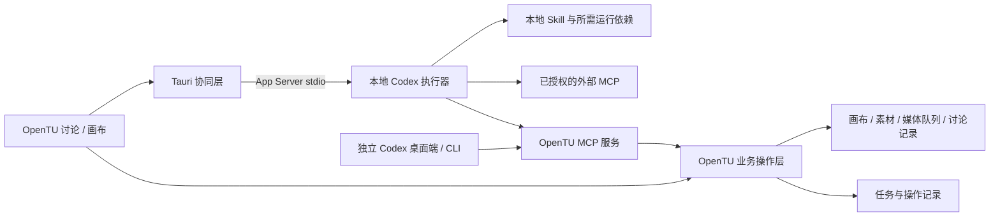

# OpenTU 与本地 Codex 双向创作协同方案

状态：2026-11-12 用户已选择 B，进入本地实施。真实付费生成与发布尚未执行。

用户已明确目标：双向协同；首期优先“讨论创作 → Codex 使用 Skill/MCP → 操作 OpenTU 画布和媒体”。当前 Codex 桌面端同一聊天的实时镜像、任意项目代码开发不作为首期必要条件。

## 1. 结论与需求评审

目标可行，建议沿现有 Rust/Tauri + Codex App Server 扩展，并新增 OpenTU MCP 服务。现有 Skill/MCP 管理可复用，但管理配置不等于在讨论中执行能力。

- 可行性：已存在 App Server 讨论桥、Skill 导入/同步、Codex MCP 配置适配、媒体任务队列和画布操作模块。
- 性能：每轮启动 Codex、重复注入全文历史和加载全部 MCP 会增加延迟；改为活动会话复用进程、空闲回收，按需加载 Skill 正文和上下文，工具事件批量刷新 UI。
- 可维护性：统一业务操作层供 UI 和 MCP 调用，协议适配集中在 Rust 层，避免两套媒体/画布逻辑。
- 扩展性：保留执行器接口，后续可增加代码项目协同；首期不再实现一个通用 Agent 运行时。
- 安全边界：Skill 可能依赖脚本和外部工具，MCP 可执行真实副作用，不能通过复制文档或关闭审批来宣称全面互通。按工作区及任务授权，输出目录、媒体预算、目标画板均由应用验证。
- 长期成本：主要来自 Codex 协议版本、Skill 依赖差异、MCP 认证及画布并发写入；需要能力探测、版本适配、兼容状态和可恢复操作记录。

“拥有 Codex 全部能力”需要细化为可验证的能力集合。可移植本地 Skill、可连接 MCP 可以共享；桌面宿主独有工具、插件内部接口、云连接器或缺失运行依赖的 Skill 必须单独探测，不承诺自动继承。

## 2. 已核实的现状

| 模块 | 当前行为 | 与目标的差距 |
| --- | --- | --- |
| `src-tauri/src/creative_codex.rs` | 启动本地 App Server；关闭 shell、apps、plugins、hooks 等；禁用继承 MCP；只读沙箱；拒绝工具审批；每轮 ephemeral 线程 | 只能回复和规划，缺少工具审批、持久线程、产物回传 |
| 创作区 `services/text-chat/local-codex.ts` | 传入历史与图片，要求返回 content/next JSON | 缺少真实工具调用、操作状态和产物事件模型 |
| `src-tauri/src/services/skill.rs` | 管理完整 Skill 目录，支持应用导入、SSOT、链接/复制同步；包含 `.agents/skills` 与 Codex 路径 | 要增加来源/版本/依赖兼容检查，防止同名覆盖 |
| `src-tauri/src/mcp/codex.rs` | 导入和同步 Codex `config.toml` 中 MCP 配置 | 不能证明服务已连接、认证成功或工具实际可调用 |
| 创作区 `external-skill-service.ts` / `external-skill-parser.ts` | 外部 Skill 文本解析、IndexedDB 保存及内置包加载 | 不等同于保留脚本、资源和运行环境的完整 Agent Skill |
| 创作区工作流与画布模块 | 有内部 MCP 风格工具、任务队列和画布插入能力 | 本次检索未见供外部 Codex 使用的完整 MCP 服务入口 |

仓库原接入记录主要基于 macOS，明确未验收 Windows/Linux 原生运行。本机只核实到 `codex-cli 0.167.0` 和离线协议；尚未验证 Windows 下完整桥接或真实推理。

本机非 experimental schema 导出包含 `thread/resume`、`turn/steer`、`skills/list`、`skills/extraRoots/set`、`mcpServerStatus/list`、`mcpServer/tool/call` 和执行/文件/权限审批请求。这证明本机协议定义提供接口，不证明全部配置、服务或账号可用。

## 3. 三种方案对比

| 方案 | 实现复杂度 | 运行性能 | 扩展性 | 维护难度 | 潜在坑点 |
| --- | --- | --- | --- | --- | --- |
| A：在现有讨论桥中放开工具，补 Skill/MCP 共享 | 低至中 | 仍有每轮启动和重复上下文开销 | 中，适合单向验证 | 初期低，继续增加功能后升高 | 缺少反向控制、可靠会话和统一执行记录，单独采用不能满足全部目标 |
| B：App Server 执行 + OpenTU MCP + 能力目录 | 中至高，可分阶段交付 | 可复用活动进程、按需发现工具；桥接开销可控 | 高，可扩展开发任务和其他 MCP 客户端 | 中，复用现有业务与 Codex 执行器 | 需处理协议兼容、任务恢复、循环调用、画布冲突及依赖适配 |
| C：OpenTU 自建通用 Agent 运行时，再对接 Codex | 高 | 能自主优化，但工具循环和双运行时更重 | 理论高，最独立 | 高，长期维护工具调用、压缩、权限与沙箱 | 重复建设，技能表现难与 Codex 一致，容易陷入两套执行语义 |

建议 B。A 可用作 B 的技术验证步骤，C 暂不建议。用户确认目标不等于已选择 B；选择后才实施。

## 4. 推荐架构 B

两条链路各有职责：App Server 让 OpenTU 获得 Codex 的执行能力；OpenTU MCP 把应用的业务能力提供给 Codex。无需假设两个客户端共用同一个聊天。

### 4.1 讨论区变成可执行的创作会话

- 明确显示连接状态、可用 Skill/MCP、当前画板和任务工作目录。
- 支持“讨论”和“执行创作”状态；讨论不会因工具存在就自动开始付费媒体生成。
- 每个讨论绑定 `workspaceId / boardId / discussionId / codexThreadId`；关联具体媒体作业，恢复时核对原目标。
- 展示真实步骤：读取参考 → 使用 Skill → 调用 MCP → 排队/执行 → 导入/排版 → 完成。显示文件、预览、失败及恢复入口。
- 文本消息、工具事件、审批、文件产物、媒体作业分别建模；不再把所有输出强行塞入生成计划 JSON。
- 执行器在活动会话中复用，空闲后释放进程；线程可持久恢复。停止推理与取消媒体作业分别呈现，停止不宣称外部作业已撤销。

### 4.2 Skill 共享与适配

统一的是能力目录与发现规则，不把两边所有存储强制合并成一个可相互覆盖的目录。

| Skill 类型 | 处理方式 |
| --- | --- |
| 本地完整 Agent Skill | 通过 Codex 能力枚举和受支持目录发现，保留 SKILL.md、scripts、references、assets 的关系 |
| 纯文本创作 Skill | 可导出为标准 Skill，标明版本与来源 |
| OpenTU 特有工作流 Skill | 提供调用 OpenTU MCP 的包装 Skill，实际动作仍由 OpenTU 执行 |
| 依赖桌面宿主或不可用工具的 Skill | 标明缺失依赖，提供适配或不可用原因，不伪装成可执行 |

优先复用现有 SSOT 和导入/同步功能，新增稳定 ID、来源、摘要指纹、版本和适用执行器。不同来源同名 Skill 不静默覆盖；复制模式检测冲突，修改不自动双向覆盖。按实际 CLI 版本处理 `.agents/skills`、既有 `.codex/skills` 和自定义路径。

在 OpenTU 内调用 Codex Skill，由 Codex 加载执行；不要求原有普通文本模型立即具备同等工具能力。用户在外部 Codex 调用 OpenTU Skill 时，由标准包装 Skill 引导到同一 MCP 操作层。

### 4.3 MCP 共享与反向控制

沿用现有 MCP 配置管理，增加“已配置 / 已启用 / 已连接 / 待授权 / 不兼容 / 出错”状态。共享连接定义及授权引用，不假设两个进程共享同一个 MCP 会话或 OAuth 生命周期。不复制认证文件到前端，也不覆盖用户全局配置。

新增 `opentu` MCP。建议首批语义工具如下，名称为拟定接口：

| 工具 | 作用 |
| --- | --- |
| `workspace.list` / `board.get` / `selection.get` | 读取允许访问的工作区、画板摘要、选中作品 |
| `discussion.read` / `discussion.append_result` | 读取关联讨论及记录结果；写入结果不自动触发另一个 Agent |
| `skills.list` / `skills.read` | 提供 OpenTU Skill 元数据及工作流说明 |
| `media.submit` / `job.get` / `job.cancel` | 提交媒体任务、查询状态、申请取消 |
| `asset.import` | 导入已生成且经过校验的本地产物 |
| `canvas.apply` | 在指定画板执行批量新增、移动、排版等操作 |
| `ui.open_board` / `ui.focus_asset` | 打开明确指定的画板或定位作品 |

业务动作调用现有队列与画布操作，不通过模拟点击实现日常控制。截图式 UI 自动化可作补充，不作为核心链路。

优先以小型 Rust stdio MCP 入口连接运行中的 Tauri 应用；Windows 采用限当前用户的本地 IPC，其他平台适配本地域套接字。连接需实例标识及授权校验，不开放裸露公网端口。应用未运行、画板未加载或权限不足时返回明确状态，不能报告操作成功；加载或切换画板应是显式动作。

### 4.4 任务一致性、权限与性能

- 每次动作携带工作区/画板/讨论/任务身份；画布写入附带 revision 检查，冲突时重新读取或返回冲突，不能写到用户刚切换的新画板。
- `operationId` 在提交前持久化并去重。网络超时导致外部结果不明时先查状态，无法确认时标为待核实，不能直接重发付费请求。
- 画布批量变更进入应用撤销记录；文件导入核查真实路径、类型、大小与指纹；已完成媒体任务不可假装通过撤销返还费用。
- 同时从 OpenTU 和 Codex 操作时，写入经过同一业务队列和版本检查。携带来源、父操作和调用深度，禁止 OpenTU→Codex→OpenTU 自动无限互调。
- 只读访问、当前任务内可撤销修改、付费生成及其他外部副作用分级。用户可授予一次任务范围和预算，范围内继续执行，避免每个细小动作反复确认；越界再询问。
- 脚本 Skill 使用明确的产物工作目录和 Codex 审批/沙箱机制。第三方 MCP 的远端副作用仍须工具级授权，不能用本地文件沙箱替代。
- UI 合并增量消息与工具事件，画布只随业务操作更新；媒体提交快速返回作业 ID，再查询或订阅状态，不长时间占住一次 MCP 请求。

## 5. 用户体验示例

### 从 OpenTU 发起

用户选中参考图，在讨论中说：“用我的品牌设计 Skill，参考这张图做 6 张不同主题海报，再按 3×2 排好。”

应用显示需要的 Skill、MCP、媒体模型、数量与任务授权范围 → Codex 读取选中素材及 Skill → 生成并执行明确计划 → OpenTU 队列生成作品 → Codex 调用画布排版 → 讨论显示结果、失败项及可继续操作。缺少 Skill 依赖时明确告知，不退化成只写一段提示词却声称完成。

### 从 Codex 发起

用户在 Codex 说：“读取 OpenTU 的品牌画板，把选中的三张图统一尺寸，补一张封面，并写回讨论记录。”

Codex 通过 OpenTU MCP 获取被授权画板及选区 → 使用共享或包装 Skill → 调用同一业务操作层 → 画布与讨论同步显示结果。首期不要求该 Codex 聊天与 OpenTU 讨论逐字镜像。

## 6. 实施顺序与验收

1. **能力探测与 Windows 验证**：可靠定位 CLI 可执行文件；完成握手、Skill 列表、MCP 状态和缺失依赖提示；先打通一个完整本地 Skill 和一个无副作用 MCP。离线 schema、模拟协议和真实运行分别记录。
2. **最小双向创作闭环**：持久讨论绑定、App Server 工具事件/审批、OpenTU MCP 首批工具、媒体队列和画布回填。验收同一画板分别由 OpenTU 和外部 Codex 发起并完成操作。
3. **能力管理完善**：共享 Skill 目录、包装 Skill、兼容诊断、来源与版本冲突、MCP 认证/重载反馈；改良讨论区过程和产物展示。
4. **恢复与交付验收**：断线、重启、取消、重复请求、画板切换、并发修改、产物重复导入和媒体结果不明场景；在明确授权额度内做真实生成，记录 Windows 实机结果。之后再考虑其他平台和代码开发工作流。

关键验收不是“列表看到了”或“模型说已完成”，而是：真实 Skill 被使用；真实 MCP 返回结果；真实作品出现在指定画板；外部 Codex 能操作同一应用；重连不重复生成；缺失能力不会被伪装为成功。

不在本轮方案阶段安装依赖、修改 Codex 配置、执行真实创作、推送或发布。实施方案待选择，具体媒体模型与费用范围在真实验收前确定。

## 7. 官方依据

- [Codex App Server](https://developers.openai.com/codex/app-server)：嵌入式客户端、线程恢复、流事件、Skill/MCP 接口及审批；实施仍以本机协议能力为准。
- [Build skills](https://learn.chatgpt.com/docs/build-skills)：Skill 目录结构、按需加载、发现路径与插件分发。
- [MCP（CLI）](https://learn.chatgpt.com/docs/extend/mcp?surface=cli)：stdio/Streamable HTTP、配置共享、认证、工具允许列表。

上述文档于 2026-11-12 实际打开核查。没有据此推断桌面端全部专有插件或当前聊天可被任意外部客户端接管。
